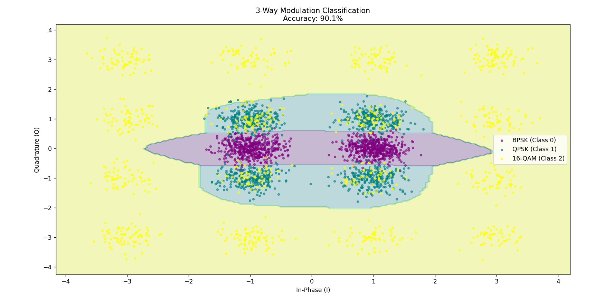

# 📡 ModulAI: Automatic Modulation Classification

**ModulAI** is a machine learning project that simulates and classifies digital radio signals. It uses a Multi-Layer Perceptron (MLP) to distinguish between **BPSK**, **QPSK**, and **16-QAM** modulation schemes under Additive White Gaussian Noise (AWGN) conditions.



## 🚀 Features
* **Synthetic Data Generation:** Simulates I/Q signals for 3 modulation types.
* **Deep Learning Classifier:** Uses a Neural Network (MLP) to learn signal geometry.
* **Visual Analysis:** Generates Decision Boundary Maps and Confusion Matrices to interpret model performance.
* **Accuracy:** Achieves ~90% accuracy on noisy channels (SNR proxy $\sigma=0.25$).

## 🛠️ Tech Stack
* **Language:** Python 3.x
* **Libraries:** `numpy`, `matplotlib`, `scikit-learn`
* **Model:** Multi-Layer Perceptron (100x50 hidden layers)

## 📊 How It Works
1.  **Data Gen:** Generates 3,000 samples with Gaussian noise.
    * `BPSK`: 2 points $(-1, 1)$
    * `QPSK`: 4 points $(\pm1, \pm1)$
    * `16-QAM`: 16 points grid
2.  **Training:** The data is scaled using `StandardScaler` and fed into an MLP Classifier.
3.  **Visualization:** The model predicts a meshgrid of points to draw the decision territories.

## 💻 Usage
1.  Clone the repository:
    ```bash
    git clone [https://github.com/YOUR_USERNAME/ModulAI.git](https://github.com/YOUR_USERNAME/ModulAI.git)
    ```
2.  Install dependencies:
    ```bash
    pip install -r requirements.txt
    ```
3.  Run the classifier:
    ```bash
    python final_project.py
    ```

## 📈 Results
The model demonstrates that lower-order modulations (BPSK) are significantly more robust to noise than higher-order schemes (16-QAM).

| Class | Robustness |
| :--- | :--- |
| **BPSK** | High (Purple Region) |
| **QPSK** | Medium (Teal Region) |
| **16-QAM** | Low (Yellow Region) |